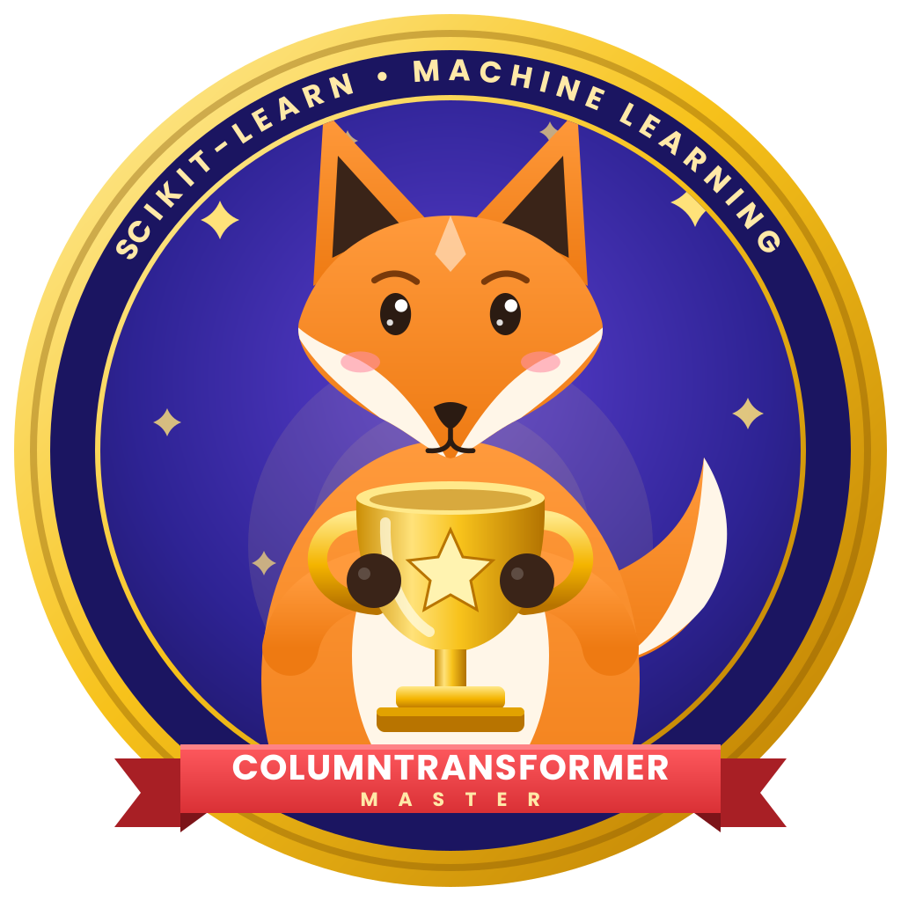

# 🦊 Belajar `ColumnTransformer` (Scikit-Learn) untuk Pemula

<p align="center">
  
</p>

> **Satu paket belajar lengkap:** materi singkat, 2 studi kasus praktik (dengan dataset), dan badge rubah emas sebagai hadiah kalau kamu berhasil menyelesaikannya. 🏆

---

## 🤔 Apa itu ColumnTransformer?

Bayangkan dapur restoran: sayur dipotong, daging dibumbui, nasi ditanak. Setiap bahan diolah **dengan cara berbeda**, lalu disajikan dalam **satu piring**.

`ColumnTransformer` melakukan hal yang sama untuk data kamu. Kolom **angka**, **kategori**, dan **teks** diproses dengan cara masing-masing, lalu digabung menjadi satu tabel angka yang siap dimakan model Machine Learning.

```python
from sklearn.compose import ColumnTransformer
from sklearn.preprocessing import StandardScaler, OneHotEncoder

prep = ColumnTransformer(
    transformers=[
        ("angka",    StandardScaler(),                       ["umur", "gaji"]),
        ("kategori", OneHotEncoder(handle_unknown="ignore"), ["kota", "paket"]),
    ],
    remainder="drop",
)
```

---

## 📦 Isi Paket

| File | Fungsi |
|---|---|
| 📄 `Materi_ColumnTransformer.pdf` | Materi ringkas **3 halaman**: konsep, sintaks, resep lengkap, jebakan umum, dan contekan |
| 📓 `Latihan_ColumnTransformer.ipynb` | Bank soal & latihan: **kuis teori + 2 studi kasus** + kunci jawaban. Dataset dibuat **otomatis di dalam notebook** |
| 🏆 `badge_columntransformer.png` | Badge hadiah **"ColumnTransformer Master"** (rubah dengan trophy emas) |
| 📝 `README.md` | Panduan yang sedang kamu baca |

---

## 🎯 Tujuan Belajar

Setelah menyelesaikan paket ini, kamu mampu:

1. Menjelaskan **kenapa** dan **kapan** `ColumnTransformer` dibutuhkan.
2. Menulis `ColumnTransformer` dengan format `(nama, transformer, kolom)`.
3. Memproses kolom **angka, kategori (ordinal & nominal), biner, dan teks** dalam satu objek.
4. Menggabungkannya dengan `Pipeline` agar **bebas data leakage**.
5. Memakai `make_column_selector`, `remainder`, `get_feature_names_out()`, dan **tuning** lewat `GridSearchCV`.
6. Mengenali dan menghindari jebakan umum (misalnya kolom teks harus berupa *string*, bukan *list*).

---

## 🧪 Isi Latihan (Notebook)

| Bagian | Topik | Level | Yang dipraktikkan |
|---|---|---|---|
| **A** | Kuis teori (8 soal) | 🟢 | Konsep dasar, dengan jawaban yang bisa dibuka |
| **B** | **Kasus 1: Prediksi Harga Rumah** 🏠 | 🟢 Mudah | `ColumnTransformer` dasar, `SimpleImputer`, `StandardScaler`, `OneHotEncoder`, `Pipeline`, `RandomForestRegressor` |
| **C** | **Kasus 2: Prediksi Pelanggan Berhenti Langganan** 📺 | 🟡 Menengah | `make_column_selector`, `OrdinalEncoder`, `passthrough`, `remainder`, output pandas, `GridSearchCV` |
| **D** | Kunci jawaban 🔑 | | Kode lengkap semua tugas |
| **E** | Klaim badge 🏆 | | Rangkuman dan cara klaim hadiah |

Selain itu ada **tantangan bonus** untuk yang masih penasaran.

### 📊 Dataset

Semua dataset **dibuat otomatis** oleh kode di dalam notebook (data sintetis, memakai *random seed* sehingga hasilnya selalu sama). Setiap dataset sengaja dibuat **realistis**, lengkap dengan data kosong (*missing value*).

| Dataset | Baris x Kolom | Target | Jenis kolom |
|---|---|---|---|
| `data_rumah.csv` | 500 x 7 | `harga_juta` (regresi) | angka, kategori, ada data kosong |
| `data_churn.csv` | 800 x 9 | `churn` (klasifikasi) | angka, ordinal, nominal, biner, ada data kosong |

> File `.csv` otomatis tersimpan di folder kerja saat sel pembuat datanya dijalankan. Di Google Colab, kamu bisa mengunduhnya dari panel **Files** di sebelah kiri.

---

## 🚀 Cara Memulai

### Opsi 1: Google Colab (paling mudah, tanpa instalasi)
1. Buka [colab.research.google.com](https://colab.research.google.com).
2. Pilih **File → Upload notebook**, lalu pilih `Latihan_ColumnTransformer.ipynb`.
3. Jalankan sel dari atas ke bawah.

### Opsi 2: Di komputer sendiri
```bash
pip install numpy pandas "scikit-learn>=1.2" jupyter
jupyter notebook Latihan_ColumnTransformer.ipynb
```

> **Catatan versi:** notebook diuji dengan scikit-learn 1.9.1. Versi **1.2 atau lebih baru** diperlukan karena memakai `set_output` dan `sparse_output`.

---

## 📖 Cara Belajar yang Disarankan

1. 👀 **Tonton** video short-nya untuk gambaran besar.
2. 📄 **Baca** PDF materi (cukup 10 menit).
3. 🧠 **Kerjakan** kuis teori di Bagian A.
4. ✏️ **Praktik** Studi Kasus 1 → 2 secara berurutan.
5. 🔑 **Intip** kunci jawaban hanya setelah mencoba sendiri.
6. 🏆 **Klaim** badge kamu!

### Cara kerja latihan
- Cari tanda **`___`** di sel kode. Itu bagian yang harus kamu isi.
- Setelah mengisi, jalankan sel **"✅ Cek jawabanmu"** di bawahnya. Kalau muncul ✅, kamu benar.
- Mentok? Buka **💡 Petunjuk** dulu, baru **Kunci Jawaban**.
- Jangan pakai *Run all* di awal, karena sel latihan memang belum terisi dan akan menampilkan error. Itu wajar. 😉

---

## 🏆 Cara Klaim Badge

Badge **"ColumnTransformer Master"** 🦊 jadi milikmu kalau kamu sudah:

- [x] Menyelesaikan kuis teori (Bagian A)
- [x] Menyelesaikan Studi Kasus 1 dan 2 (semua sel "Cek jawabanmu" menampilkan ✅)

Lalu **screenshot** hasil akhir notebook kamu, pasang badge di profilmu, dan ceritakan satu hal baru yang kamu pelajari. Selamat, calon ML Master! 🎉

---

## ❓ Pertanyaan yang Sering Muncul

**Kenapa muncul error `NameError: name '___' is not defined`?**
Itu artinya ada bagian `___` yang belum kamu isi. Ganti dengan jawabanmu lalu jalankan lagi.

**Kenapa hasil kamu sedikit berbeda dengan kunci jawaban?**
Pastikan kamu memakai `random_state=42` saat split data dan saat membuat model, serta tidak mengubah dataset.

**Boleh dipakai untuk data sendiri?**
Boleh banget! Ganti DataFrame-nya dengan data milikmu, lalu sesuaikan daftar kolom angka, kategori, dan teks.

---

## 🧰 Teknologi

Python 3 · NumPy · pandas · scikit-learn

**Selamat belajar dan sampai jumpa di topik berikutnya! 🦊✨**
